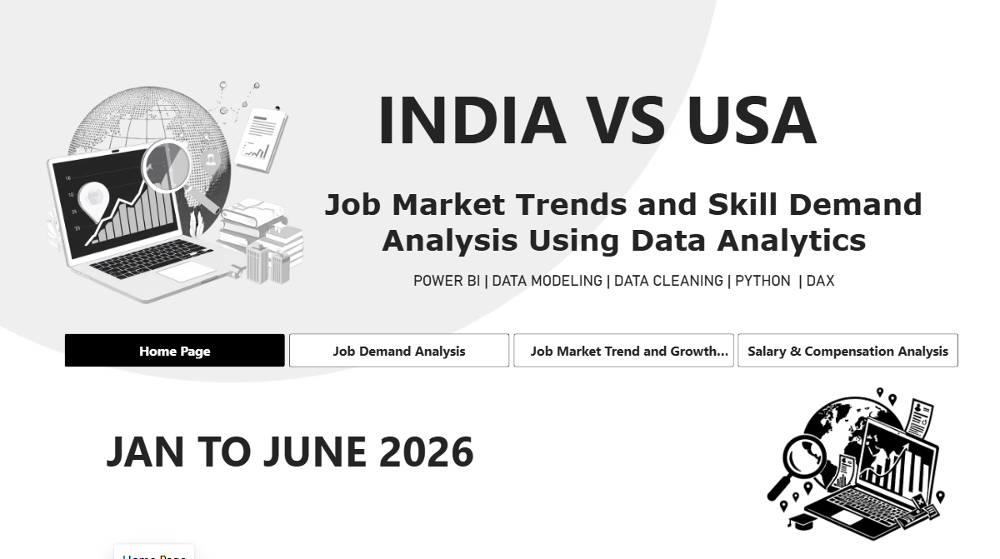
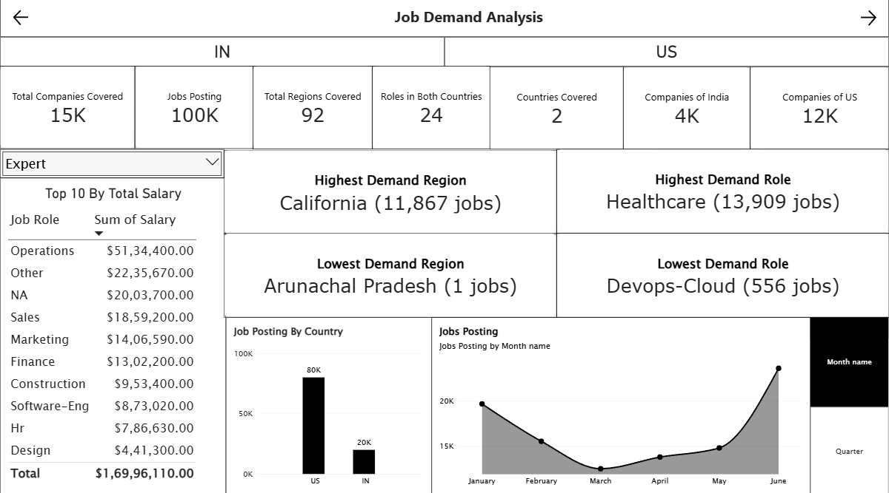
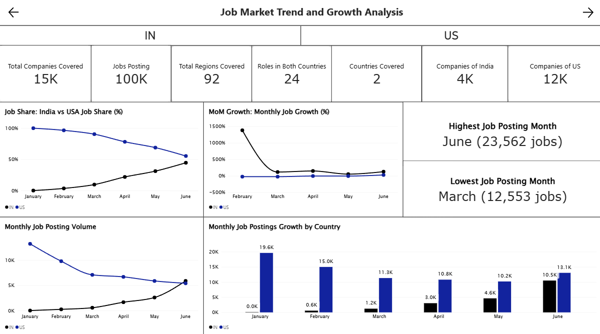
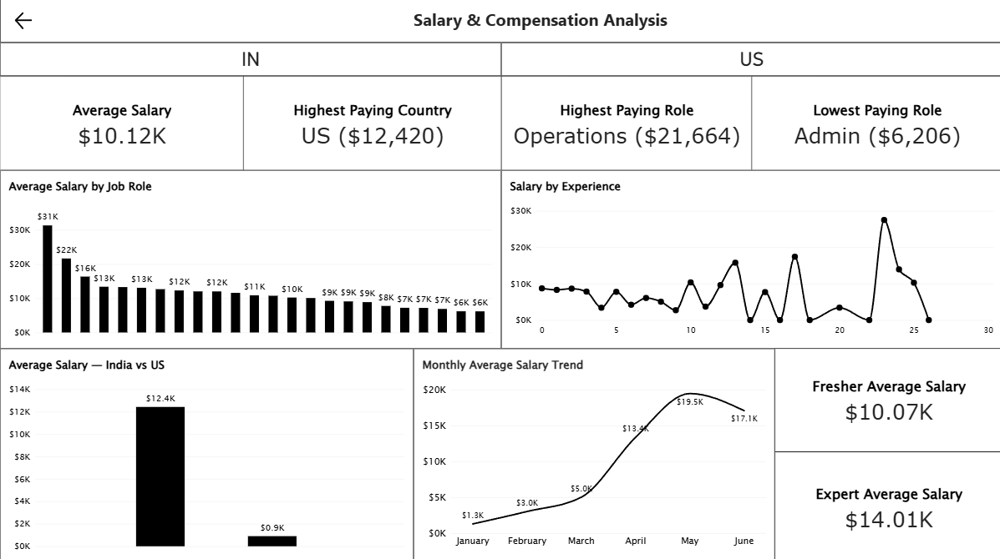

# India vs US – Job Market Trends, Demand and Salary Analysis (Jan–Jun 2026)

An interactive **Power BI data analytics project** analysing job postings from India and the United States between January and June 2026. The dashboard supports **country-wise filtering** through interactive IN and US slicers, and shows a **combined job market view** when no country is selected. It explores job posting demand, monthly market trends, company distribution, regional demand and salary patterns.

## 📌 Project Overview

The objective of this project is to analyse job posting data from India and the USA to understand:

-   Job demand across job roles, companies and regions.
-   Which job roles and regions have the highest and lowest demand.
-   How job postings change month over month.
-   How average salaries vary across job roles, countries and experience levels.
-   What insights can be extracted from job market data to support career and business decisions.

## 🎯 Project Objectives

-   Analyse job posting distribution through a combined view and country-level analysis.
-   Identify high-demand and low-demand job roles.
-   Analyse company and regional distribution.
-   Track monthly job posting volume and growth.
-   Evaluate average annual salaries by country, job role and experience level.
-   Build an interactive dashboard using Power BI.

## 🖱️ How the Country Slicers Work

The **IN** and **US** buttons at the top of the dashboard are interactive **country slicers**. They are not separate dashboards and do not create a side-by-side comparison layout.

-   **IN selected:** visuals are filtered to show India data only.
-   **US selected:** visuals are filtered to show USA data only.
-   **No country selected:** visuals show the **combined India and USA job market view**.

This allows country-level analysis on every page while keeping a single, consistent dashboard design. Where a visual displays both countries together (for example, in the combined view), it reflects the combined data rather than a dedicated comparison.

## 📊 Dashboard Pages

### 1. Home Page

Provides an overview of the project, analysis period and navigation to all dashboard sections, along with the IN and US country slicers.



### 2. Job Demand Analysis

Analyses job posting demand across companies, regions and job roles, with country-wise filtering available through the slicers.

**Key analysis:**

-   Total job postings and companies covered.
-   Total regions and countries covered.
-   Job posting distribution by country (combined job market view).
-   Highest and lowest demand regions.
-   Highest and lowest demand job roles.
-   Top 10 job roles by total salary.



### 3. Job Market Trends and Growth Analysis

Explores monthly job posting patterns using the combined job market view, which can be narrowed to country-level analysis with the slicers.

**Key analysis:**

-   Job market share by country.
-   Month-over-Month (MoM) job growth.
-   Monthly job posting volume.
-   Country-wise monthly posting trends.
-   Highest and lowest job posting months.



### 4. Salary and Compensation Analysis

Examines salary patterns across job roles, countries and experience levels, with country-wise filtering.

**Key analysis:**

-   Average annual salary.
-   Highest-paying and lowest-paying job roles.
-   Highest-paying country.
-   Average salary by job role.
-   Country-level average salary analysis.
-   Salary trend by month.
-   Average salary for Freshers and Experts.



## 🔍 Key Insights

Based on the dashboard results:

-   **Job demand:** Healthcare is the highest-demand job role, with approximately 13,909 postings.
-   **Regional demand:** California leads with approximately 11,867 job postings.
-   **Monthly demand (combined view):** June records the highest posting volume, with approximately 23,562 combined postings, while March records the lowest, with approximately 12,553 combined postings.
-   **Monthly demand (India only):** When the India slicer is selected, January is the lowest month.
-   **Salary by country:** The USA has a higher average annual salary than India in this dataset.
-   **Highest-paying role:** Operations, with an average salary of approximately \$21,664.
-   **Lowest-paying role:** Admin, with an average salary of approximately \$6,206.
-   **Experience comparison:** Expert-level jobs have an average salary of approximately \$14.01K, compared with \$10.07K for Freshers.

*Note: These findings represent the dataset and the selected dashboard filters. They should not be interpreted as official estimates of the entire job market.*

## 🛠️ Tools & Technologies

| Tool             | Purpose                             |
| ---------------- | ----------------------------------- |
| Power BI Desktop | Interactive dashboard development   |
| Power Query      | Data cleaning and transformation    |
| DAX              | Measures, KPIs and calculations     |
| Data Modeling    | Star schema and table relationships |
| Python           | Data analysis and preparation       |

## 🧹 Data Preparation & Modeling

The project includes the following data preparation activities:

-   Data cleaning and handling missing values.
-   Removing duplicate records where appropriate.
-   Data type corrections and transformations.
-   Creating dimension tables for companies, locations, job roles, education and work modes.
-   Creating a date dimension for time-based analysis.
-   Building a star schema with a central fact table and related dimension tables.
-   Establishing relationships between fact and dimension tables.

### Data Model

The project uses **Star Schema** data modelling:

-   **Fact Table:** `Fact_JobPostings`
-   **Dimension Tables:** `Dim_Company`, `Dim_Location`, `Dim_JobRole`, `Dim_Education`, `Dim_WorkMode` and `Dim_Date`.

## 📐 Key DAX Measures

Some of the calculations used in this project include:

-   Total Job Postings
-   Total Companies
-   Total Locations
-   Average Salary
-   Median Salary
-   Previous Month Jobs
-   MoM Job Growth %
-   Job Market Share %
-   Fresher Average Salary
-   Expert Average Salary
-   Highest Demand Role
-   Highest Paying Role

## 📅 Dataset Information

| Attribute       | Details                                             |
| --------------- | --------------------------------------------------- |
| Source          | Fliar BI – Job Postings 2026                        |
| Sample Size     | 100,009 records                                     |
| Countries       | India and USA                                       |
| Period          | January–June 2026                                   |
| Data Category   | Job Postings                                        |
| Key Metrics     | Job Demand, Company Distribution, Salary and Growth |
| Salary Currency | USD                                                 |
| Tool            | Power BI                                            |

**Dataset Source:** [Fliar BI – Job Postings 2026](https://fliarbi.com/datasets/job-postings-2026/)

### Sample Size and Comparison with the Fliar Research Report

This project uses a **100,009-row sample** of the dataset. The accompanying Fliar Research report covers approximately **1.65 million records**. Because of the smaller sample size and differences in employer selection, some findings in this dashboard may differ from those reported in the Fliar Research report.

## ⚠️ Limitations

-   **Salary availability:** Salary information is not available for every job posting, so salary analysis reflects only the records that include salary data.
-   **Changing data collection coverage:** The coverage of data collection may change over time, which can influence monthly trends and growth figures.
-   **Postings are not hires:** Job postings do not necessarily represent actual hires or filled positions.
-   **Sample-based analysis:** Results are based on a 100,009-row sample and may differ from analyses of the full dataset.
-   **Employer selection:** The mix of employers in the sample may affect demand and salary findings.
-   **Country filtering:** Country-level results depend on the slicer selection; the combined view should not be read as a direct side-by-side comparison.

## 📁 Repository Structure

``` text
Job Market Trends and Skill Demand Analysis Using Data Analytics/
│
├── screenshots/
│   ├── home-page.png
│   ├── job-demand-analysis.png
│   ├── job-market-trends.png
│   └── salary-analysis.png
│
├── dataset/
│   └── README.md
│
├── power-bi/
│   └── India-USA-Job-Market-Analysis.pbix
│
└── README.md
```

## 🚀 Project Outcomes

Through this project, I gained practical experience in:

-   Data cleaning and transformation using Power Query.
-   Designing a star schema for analytical reporting.
-   Creating DAX measures and calculated KPIs.
-   Performing country-level and time-based analysis.
-   Building interactive dashboards with country slicers in Power BI.
-   Converting raw job posting data into meaningful business insights.

## 👨‍💻 Author

**Manjeet Gupta**

SY B.Sc. Artificial Intelligence & Machine Learning

Interested in Data Analytics, Data Science and Business Intelligence.

-   [LinkedIn](https://www.linkedin.com/in/manjeet-gupta-731409296/)
-   [Portfolio](https://manjeetgupta.vercel.app/)
-   [Source of Dataset](https://fliarbi.com/datasets/job-postings-2026/)

------------------------------------------------------------------------

⭐ If you find this project interesting, feel free to explore the dashboard and share your feedback.

**#PowerBI #DataAnalytics #DAX #PowerQuery #DataVisualization #JobMarketAnalysis #DataModeling**
